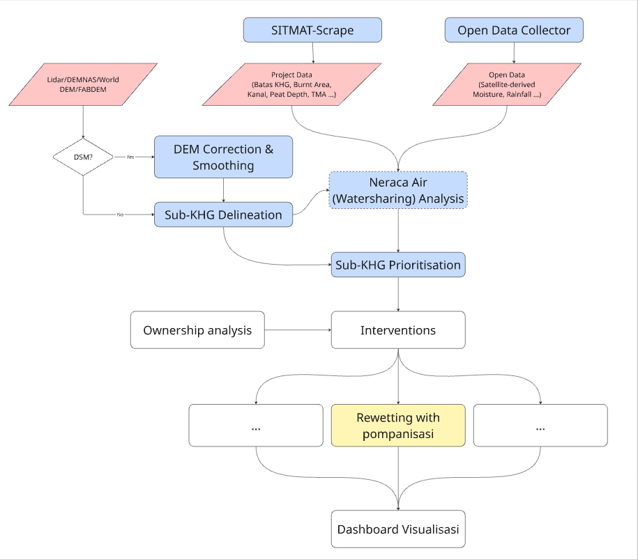

# RE-PEAT

Peatland rewetting toolkit of the RE-PEAT project (World Bank, KLH), GIS workstream, Departemen Teknik Geodesi UGM. GitHub organisation: Re-Peat-Project.

This repository is the hub. It holds no pipeline code. It holds what ties the modules together: the documentation, the data contracts between modules, and the per-site configs, runbooks and reports of the KHG we have run.



## The modules

Each module is its own repository. They exchange files, never imports; the files are defined in [docs/11-data-contracts.md](docs/11-data-contracts.md).

| Module | Does | Folder today |
|---|---|---|
| `repeat-sitmat` | Downloads water-table (TMA) data from SiTMAT; dashboard | `apps/sitmat-extract` |
| `repeat-common` | Library: open-data readers (Sentinel, ERA5, CHIRPS, WaPOR, ...), grid helpers, SiTMAT reader, config helpers | `repeat-common` |
| `repeat-dem` | DEMNAS correction and smoothing to a ground surface; the open-DEM investigation | `demnas-corrections` |
| `repeat-delineation` | Sub-KHG delineation from a DTM, rivers and canals | `repeat-delineation` |
| `repeat-neraca` | Neraca air (water balance): physical model, KHG deficit, earlier bucket experiments | `repeat-neraca` |
| `repeat-prioritisation` | National (which KHG) and sub-KHG (which area inside a KHG) prioritisation | `khg-prioritisation-module` |
| `repeat-pump` | Rewetting with pompanisasi: canal blocks, water sources, routes, pump sizing; QGIS plugin | `rewetting-algorithm` |

The folder names of four modules still differ from the repository names; they are renamed when the repositories are created in the organisation.

## Set up a workstation

Clone every repository next to this one. Then, in one Python 3.11+ environment:

```bash
pip install -e ../repeat-common ../repeat-delineation "../repeat-neraca[neraca,experiments]"
pip install -r ../khg-prioritisation-module/requirements.txt
```

Environment variables used by the site configs (a missing one stops the run with a message):

| Variable | Points to |
|---|---|
| `REPEAT_DATA` | the REPEAT-LH `_data` folder: `Peat depth and DTM`, `_converted`, ... |
| `REPEAT_WORK` | a folder for derived data: clipped vectors, caches, outputs. For the national profile it is this repository's `reports/` folder, so the report is pushed with it (its `.gpkg` files are git-ignored; rebuild them with the profile run). Other modules still use `repeat-prioritisation/data_local`. |
| `SITMAT_PROCESSED` | `sitmat-extract/sitmat_out/processed` |

## Sites

The team selected 12 main KHG (plus reserves): see [docs/13-selected-khg.md](docs/13-selected-khg.md) and [sites/selected_khg.csv](sites/selected_khg.csv). One name (cawang-lalang) is still to be confirmed.

[sites/](sites/) has one folder per KHG that has been run:

| Site | KHG id | What is there |
|---|---|---|
| [kampar_gaung](sites/kampar_gaung/README.md) | 71 | Sungai Kampar - Sungai Gaung (Riau), 7,115 km2 |
| [sugihan_lumpur](sites/sugihan_lumpur/README.md) | 16.02.01 | Sungai Sugihan - Sungai Lumpur (South Sumatra), 6,348 km2 |

Each site folder has a README (the runbook: steps with the repository each runs in, decisions and reasons, results), one config per module (`delineate.yaml`, `subkhg.yaml`, `neraca.yaml` for the physical model, `neraca_experiments.yaml`) and `reports/`. These are test runs of the whole chain, not validated rankings.

## Data catalogue

[docs/14-data-catalog.md](docs/14-data-catalog.md) lists every file in `_data` (format, CRS, resolution, features, remarks). It is generated: run `python tools/catalog_data.py` after adding data; new files are appended and hand-written remarks in [sites/data_catalog.csv](sites/data_catalog.csv) are kept.

## National profile

[docs/15-national-profile.md](docs/15-national-profile.md) profiles and ranks all 865 KHG from the local layers (fire history, hotspots, canals) and builds an HTML report; the registry of official KHG codes is [sites/khg_registry.csv](sites/khg_registry.csv). Tools: `tools/fetch_firms.py` and `tools/fetch_peat_extent.py` (wrappers: the code is `repeat_common.fetch_firms` and `repeat_common.fetch_peat_extent` in repeat-common), `tools/parse_kepmen_khg.py` (needs pdfplumber), `tools/catalog_data.py`.

## Documentation

[docs/README.md](docs/README.md) is the index: background and terms, parameter register, pitfalls, DEMNAS literature, the build plan, neraca air, and the data contracts. Method pages written before the split name the old code layout; each has a note at the top saying where the code lives now.

## Rules

- Data never goes into a repository. Paths come from the environment variables above.
- A module changes what it likes inside; what it reads and writes between modules changes only after [docs/11-data-contracts.md](docs/11-data-contracts.md) does.
- A change to `repeat-common` changes every module: re-run the site checks of the modules that use it.
