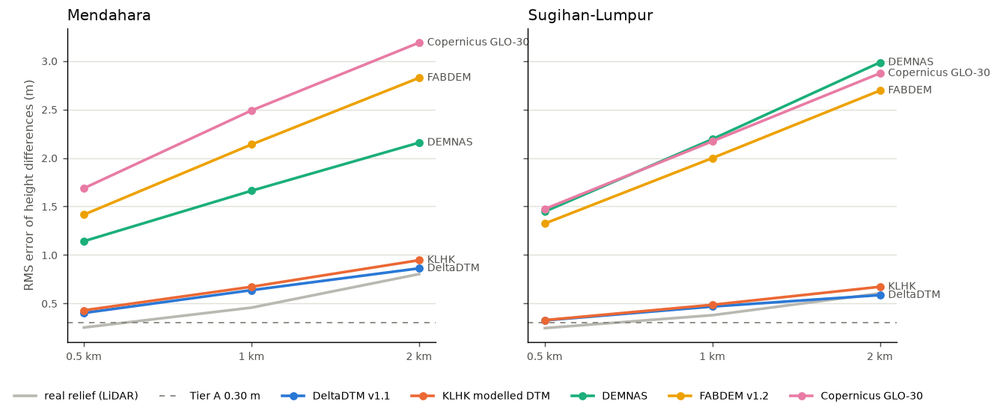
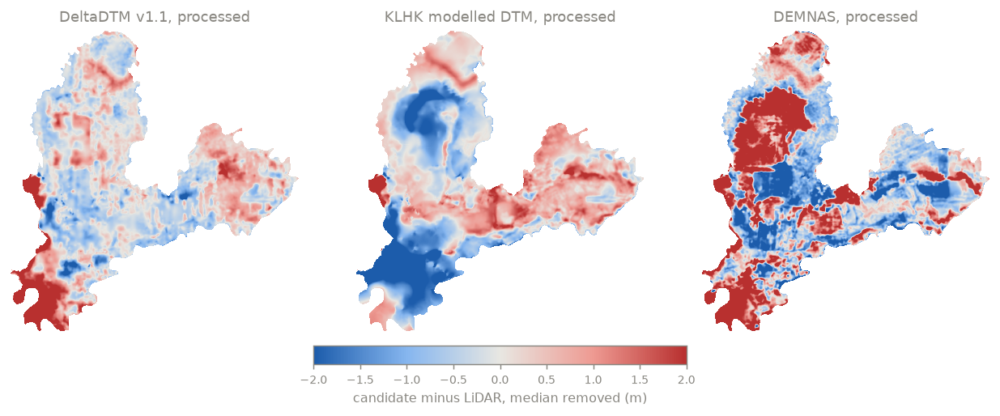
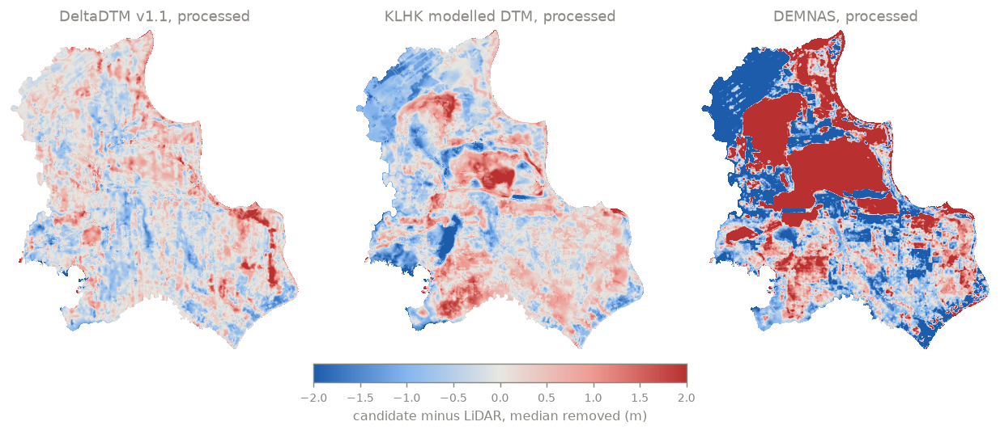
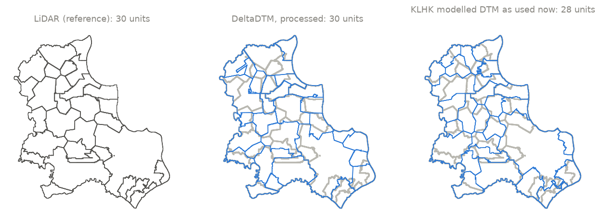

# Elevation sources for sub-KHG neraca air: a LiDAR benchmark at two KHG

Prepared by the RE-PEAT GIS team, Departemen Teknik Geodesi UGM, 2026-10-25. Every number in this report is read from the benchmark output files, and the report (`report.md`, with an HTML copy) is regenerated by `re-peat/tools/dem_benchmark_report.py`.

## Summary

Where a KHG has no airborne LiDAR, we need another elevation source for sub-KHG delineation and the neraca air (water balance). This benchmark asks which source comes closest, and whether the repeat-dem processing improves it.

- We tested five sources at two KHG with full LiDAR coverage: DEMNAS, the KLHK modelled DTM, Copernicus GLO-30, FABDEM v1.2 and DeltaDTM v1.1. Each was scored as delivered and again after the repeat-dem processing, which calibrates the surface per land-cover class with ICESat-2 and then smooths it. The LiDAR served only as the reference and never entered a fit.
- DeltaDTM after processing came closest to the LiDAR at both sites. Its error of height differences over 1 km was 0.64 m at Mendahara and 0.47 m at Sugihan-Lumpur. The KLHK modelled DTM was second (0.67 m and 0.49 m). DEMNAS, GLO-30 and FABDEM stayed at 1.7 to 2.5 m even after processing.
- No source met the pass criterion we set before the run. These peatlands are very flat: over 1 km the LiDAR itself changes by only 0.46 m (Mendahara) and 0.38 m (Sugihan-Lumpur) RMS, and even the best errors are larger than that relief.
- In the pipeline test at Sugihan-Lumpur, the sub-KHG units delineated from the processed DeltaDTM matched the LiDAR units best, with a mean best-match IoU of 0.48 against 0.40 for the DTM the pipeline uses now. That is still a weak match.
- The neraca air model in its current set-up cannot tell the DTMs apart. 77% of its grid cells have fixed heads at the canals and the KHG edge, and it shows no skill at the water-table stations even when it runs on the LiDAR.

## Sites and reference

| KHG | Area (km²) | LiDAR reference (25 m) | LiDAR cells inside the KHG | Real 1 km height difference (m RMS) | ICESat-2 ATL08 points |
|---|---|---|---|---|---|
| KHG Sungai Mendahara - Sungai Batanghari | 2,012 | `lidar_klhk/dem_25m/DEM25M/Jambi25m.tif` | 3,219,296 | 0.46 | 68,979 |
| KHG Sungai Sugihan - Sungai Lumpur | 6,347 | `lidar_klhk/dem_25m/DEM25M/OKI25.tif` | 10,151,210 | 0.38 | 266,462 |

Both LiDAR rasters come from the KLHK Direktorat Gambut archive at 25 m. Their flight dates and vertical datum were never recorded, and no further metadata can be obtained. Every processed candidate sits +0.6 to +1.0 m above them. A constant offset like this does not affect height differences, which are what the metrics below measure.

We checked whether a 25 m reference is fine enough on the 2 m LiDAR of Pulau Padang (`repeat-dem/script/reference_resolution_test.py`). Averaged into 24 m blocks, its heights vary by a median of 0.05 m inside a block, and 5% of blocks hold more than 1 m of relief (canals, ditches and embankments). The real height difference between blocks 1 km apart is 1.35 m RMS. A 25 m reference therefore keeps the dome-scale relief the water balance needs and loses the canal-scale detail.

## Data

| Dataset | What it is | Processed at | Source (from the data catalogue) | Folder in _data |
|---|---|---|---|---|
| DeltaDTM v1.1 | (land below ~10 m +MSL) | 30 m | Pronk et al. 2024 (doi:10.1038/s41597-024-03091-9), data doi:10.4121/21997565 (4TU, CC BY 4.0). Fetched through Earth Engine asset projects/sat-io/open-datasets/DELTARES/deltadtm_v1-1 (GEE community catalog) with repeat_common.gee, project ee-danylaksono, 2026-10-25. | `dem/open/deltadtm/` |
| KLHK modelled DTM | BRGM/, 0.4 arcsec, method unknown | 12 m | KLHK Direktorat Gambut archive (folder named 'DIREKTORAT GAMBUT KLHK (2015-2024)' in the LiDAR log) | `Peat depth and DTM/DTM_Sumatera-002/02_Jambi/` |
| DEMNAS | BIG  sheets, 0.27 arcsec, DSM | 8 m | BIG DEMNAS via tanahair.indonesia.go.id, fetched with repeat_common.fetch_demnas (user token | `dem/demnas_tiles/` |
| FABDEM v1.2 | FABDEM v1.2 | 30 m | Hawker et al. 2022 (doi:10.1088/1748-9326/ac4d4f) | `dem/open/fabdem/` |
| Copernicus GLO-30 | DSM | 30 m | ESA Copernicus DEM, AWS open data (copernicus-dem-30m), fetched with repeat_common.fetch_open_dem. | `dem/open/glo30/` |
| LiDAR DEM (reference) | 25 m, KLHK archive |  | KLHK Direktorat Gambut LiDAR archive (2015-2024) | `lidar_klhk/dem_25m/` |
| ICESat-2 ATL08 | ground heights 2019 to 2025 |  | NASA/NSIDC ICESat-2 ATL08 v7 (doi:10.5067/ATLAS/ATL08.007) via SlideRule | `icesat2/` |
| ESA WorldCover 2021 | 10 m land cover |  |  | `dem/open/worldcover/` |
| Meta/WRI canopy height | 1.2 m canopy height |  | Tolan et al. 2024 (doi:10.1016/j.rse.2023.113888) | `canopy/meta_chm_v1/` |

All inputs are stored in the project data folder and listed in the data catalogue with their source, licence and date. Scripts in `repeat-common` fetch them, and nothing was resampled when it was stored. DeltaDTM came through Google Earth Engine because its home repository (4TU) could not be reached from our network.

## Method

| Step | Script (repeat-dem/script) | What it does | Output (_khg/<code>_<name>/01_dem/benchmark/) |
|---|---|---|---|
| 00 | `dem_benchmark.py` | List every input with its sha256 | `00_inputs/manifest.csv` |
| 01 | `dem_benchmark.py` | Mosaic each candidate by reference (no copy, no resampling) | `01_candidates/*.vrt` |
| 02 | `dem_benchmark.py` | Candidate minus LiDAR at every LiDAR cell inside the KHG | `02_error_maps/*.tif` |
| 03 | `dem_benchmark.py` | NMAD, error of height differences over 0.5, 1 and 2 km (all cell pairs), variogram, per land cover, tiers | `03_metrics/*.csv` |
| 04 | `dem_benchmark_process.py`, `tiled_dtm.py` | repeat-dem method at native resolution: canopy factor and offset per land-cover class fitted to ICESat-2, then despike and smoothing (median 300 m, gaussian 150 m) | `04_processed/<candidate>/` |
| 05 | `dem_benchmark_pipeline.py` | Delineation and neraca air (tier 1 and 2) with only the DTM changed; neraca on the LiDAR units | `05_pipeline/` |

We wrote the pass criterion into the site configuration before any result existed. Tier A requires the error of height differences over 1 km to be at most 0.30 m, one canal-block head drop. Tier B requires it to be at most half the real 1 km height difference in that site's LiDAR.

Every candidate was processed at its own resolution, with no coarsening. DEMNAS at 8 m over Sugihan-Lumpur did not fit in memory, so its processing ran in strips with at least 2 km of overlap. On a test grid, the strip run reproduced the single-pass run to within 0.000000 m in every cell (`repeat-dem/script/check_tiling.py`).

## Results: terrain

*Error of height differences between LiDAR cells 0.5, 1 and 2 km apart, after processing (lower is better). Grey: the real height difference in the LiDAR. Dashed: Tier A.*

| Site | Candidate | State | NMAD (m) | Δh error 0.5 km (m) | Δh error 1 km (m) | Δh error 2 km (m) | Tier A | Tier B |
|---|---|---|---|---|---|---|---|---|
| Mendahara | DeltaDTM v1.1 | as delivered | 0.68 | 0.54 | 0.74 | 0.94 | fail | fail |
| Mendahara | DeltaDTM v1.1 | processed | 0.64 | 0.40 | 0.64 | 0.86 | fail | fail |
| Mendahara | KLHK modelled DTM | as delivered | 1.10 | 0.61 | 0.80 | 1.05 | fail | fail |
| Mendahara | KLHK modelled DTM | processed | 1.07 | 0.43 | 0.67 | 0.95 | fail | fail |
| Mendahara | DEMNAS | as delivered | 2.12 | 2.70 | 2.94 | 3.25 | fail | fail |
| Mendahara | DEMNAS | processed | 1.60 | 1.14 | 1.66 | 2.16 | fail | fail |
| Mendahara | FABDEM v1.2 | as delivered | 1.58 | 2.31 | 2.84 | 3.40 | fail | fail |
| Mendahara | FABDEM v1.2 | processed | 1.43 | 1.42 | 2.14 | 2.83 | fail | fail |
| Mendahara | Copernicus GLO-30 | as delivered | 3.10 | 3.54 | 4.08 | 4.69 | fail | fail |
| Mendahara | Copernicus GLO-30 | processed | 2.09 | 1.69 | 2.49 | 3.19 | fail | fail |
| Sugihan-Lumpur | DeltaDTM v1.1 | as delivered | 0.49 | 0.45 | 0.56 | 0.66 | fail | fail |
| Sugihan-Lumpur | DeltaDTM v1.1 | processed | 0.46 | 0.33 | 0.47 | 0.59 | fail | fail |
| Sugihan-Lumpur | KLHK modelled DTM | as delivered | 0.71 | 0.35 | 0.49 | 0.66 | fail | fail |
| Sugihan-Lumpur | KLHK modelled DTM | processed | 0.70 | 0.33 | 0.49 | 0.67 | fail | fail |
| Sugihan-Lumpur | DEMNAS | as delivered | 3.21 | 2.89 | 3.46 | 4.15 | fail | fail |
| Sugihan-Lumpur | DEMNAS | processed | 2.28 | 1.45 | 2.19 | 2.98 | fail | fail |
| Sugihan-Lumpur | FABDEM v1.2 | as delivered | 2.44 | 2.10 | 2.65 | 3.29 | fail | fail |
| Sugihan-Lumpur | FABDEM v1.2 | processed | 2.10 | 1.32 | 2.00 | 2.69 | fail | fail |
| Sugihan-Lumpur | Copernicus GLO-30 | as delivered | 3.21 | 2.92 | 3.47 | 4.12 | fail | fail |
| Sugihan-Lumpur | Copernicus GLO-30 | processed | 2.20 | 1.47 | 2.17 | 2.87 | fail | fail |

*Against the LiDAR as is; the comparison against the LiDAR smoothed the same way gives the same ranking (_khg/<code>_<name>/01_dem/benchmark/README.md).*

Processing helps the surface models most, because it removes part of the canopy. DEMNAS improved from 2.94 to 1.66 m at Mendahara and from 3.46 to 2.19 m at Sugihan-Lumpur. DeltaDTM and the KLHK modelled DTM are already bare-earth surfaces and gained little.

At every source the error grows with distance (see the chart), so what remains is a regional tilt or bow in the surface. More smoothing will not remove it.

| Site | Land cover (WorldCover) | Share of LiDAR cells | DeltaDTM | KLHK modelled | DEMNAS |
|---|---|---|---|---|---|
| Mendahara | tree cover | 82% | 0.62 | 1.15 | 1.70 |
| Mendahara | shrubland | 6% | 0.66 | 0.46 | 0.91 |
| Mendahara | grassland | 8% | 0.69 | 0.90 | 1.18 |
| Mendahara | cropland | 2% | 0.71 | 1.01 | 1.68 |
| Sugihan-Lumpur | tree cover | 49% | 0.45 | 0.72 | 2.65 |
| Sugihan-Lumpur | shrubland | 8% | 0.45 | 0.52 | 1.36 |
| Sugihan-Lumpur | grassland | 18% | 0.48 | 0.68 | 1.65 |
| Sugihan-Lumpur | cropland | 19% | 0.40 | 0.71 | 3.05 |
| Sugihan-Lumpur | mangroves | 4% | 0.40 | 0.41 | 2.85 |

*NMAD of candidate minus LiDAR (m) after processing, per land-cover class with at least 2% of the cells.*

*Mendahara: candidate minus LiDAR after processing, median removed. Blue = candidate too low, red = too high.*

*Sugihan-Lumpur: candidate minus LiDAR after processing, median removed. Blue = candidate too low, red = too high.*

## Results: pipeline at Sugihan-Lumpur

| DTM | Sub-KHG units | Mean best-match IoU with LiDAR units | Median IoU | KHG area in matched overlap |
|---|---|---|---|---|
| LiDAR (reference) | 30 | 1.00 | 1.00 | 100% |
| KLHK modelled DTM, as used now | 28 | 0.40 | 0.36 | 66% |
| KLHK modelled DTM, processed | 29 | 0.45 | 0.41 | 66% |
| DeltaDTM, processed | 30 | 0.48 | 0.47 | 70% |
| DEMNAS, processed | 30 | 0.38 | 0.34 | 58% |

*Sub-KHG units at Sugihan-Lumpur. Grey: the LiDAR units under each candidate.*

The mapped rivers and primary canals are always unit boundaries, so part of the boundary network is the same for every DTM. The terrain decides how the pieces between those channels form and merge. With the processed DeltaDTM, 70% of the KHG area falls in matched overlap with the LiDAR units, against 66% for the current DTM.

| DTM | Rank correlation with stations: mean level | Rank correlation: peak depth | Bias at stations (cm) |
|---|---|---|---|
| LiDAR (reference) | -0.01 | 0.19 | +77.0 |
| KLHK modelled DTM, as used now | -0.01 | 0.08 | +77.0 |
| KLHK modelled DTM, processed | 0.24 | 0.28 | +77.0 |
| DeltaDTM, processed | 0.06 | 0.19 | +77.0 |
| DEMNAS, processed | -0.51 | -0.52 | +77.0 |

*Tier 2 groundwater model on a 500 m grid; 19,433 of 25,391 cells (77%) are canal or edge cells with fixed heads. Same forcing and units for every DTM.*

## Issues found on the way

- The repeat-dem DEM loader cropped the mosaic with bounds that did not line up with the source grid, which shifted it by part of a cell before reprojection: against exact interpolation it was off by 0.25 m NMAD, against 0.01 m after the fix (`repeat-dem/script/check_load_alignment.py`, Mendahara GLO-30). It is fixed. Earlier repeat-dem results, including the first Pulau Padang LiDAR comparison, were made with the old loader.
- The 25 cm LiDAR contours from KLHK were traced from the 25 m (and 20 m) LiDAR rasters, so they add no detail. The BRGM contours were traced from the KLHK modelled DTMs.
- At Air Hitam Laut, the KLHK modelled DTM on disk is a different version from the one BRGM used.

## Limits

- There are two sites, both in the eastern Sumatra lowland, and one kind of reference: 25 m LiDAR of unknown date and datum.
- The ICESat-2 points (2019 to 2025) are newer than the LiDAR and the global models (GLO-30 comes from TanDEM-X data of 2011 to 2015), so peat subsidence since then is part of the errors.
- Its makers may have calibrated the KLHK modelled DTM to this same LiDAR, and nothing records how it was made. If they did, its scores at these two sites are better than it would get elsewhere. We have not yet tested this.
- Some ICESat-2 granules failed to read on the server, so the calibration points are slightly incomplete.
- The neraca air model is still being built, so its result here says nothing yet about the DTMs.

## What we recommend next

- Use the processed DeltaDTM as the interim terrain for KHG without LiDAR, with the mapped rivers and primary canals as unit boundaries, and carry its measured error (0.64 to 0.47 m over 1 km) into the neraca uncertainty.
- Try a trend correction from ICESat-2 (regression-kriging, which fits and removes the long-range part of the error). The error behaves as a regional tilt, and that is what such a correction targets.
- Test whether the KLHK modelled DTM does as well away from LiDAR by comparing it with ICESat-2 inside and outside the LiDAR footprints.
- Revisit the neraca grid set-up (canal cells with fixed heads) before using it to judge terrain.
- Add GEDTM30 when its host is reachable again.

## How to reproduce

| Step | Command (run in repeat-dem unless noted) |
|---|---|
| Data | `python -m repeat_common.fetch_demnas`, `fetch_open_dem`, `fetch_icesat2`, `repeat_common.gee` (see each docstring) |
| 00-03 | `python script/dem_benchmark.py benchmark/<site>.yaml` |
| 04 | `python script/dem_benchmark_process.py benchmark/<site>.yaml`, then step 00-03 again |
| 05 | `python script/dem_benchmark_pipeline.py benchmark/sugihan_lumpur.yaml` |
| Report | `python tools/dem_benchmark_report.py` (in re-peat) |
