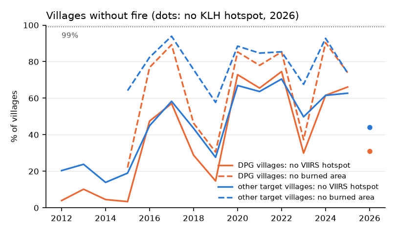
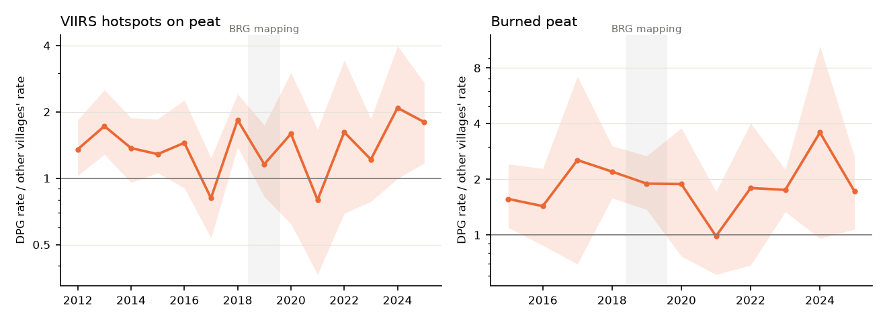
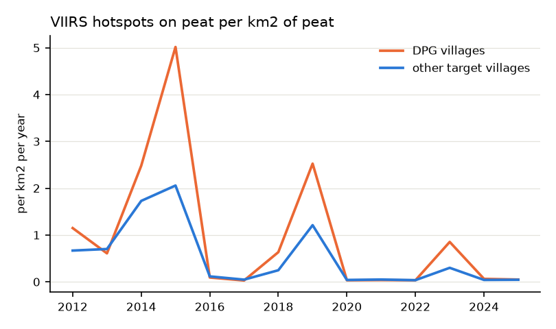

# Do Desa Peduli Gambut villages burn less?

Generated by `python -m investigations.dmpg --config configs/investigations/dmpg.yaml`. Data and limits: last sections. Interactive page with maps: [dmpg.html](dmpg.html).

## Question

The World Bank asked whether DMPG villages are safe from fire and whether DMPG should weigh in the prioritisation. KLH stated in a meeting that 99% of DMPG villages had no fire; no source file for that figure is in the workspace.

## Villages

- DPG: 177 of the 244 villages of the BRG Atlas Desa Peduli Gambut (participatory mapping June 2018 to July 2019), matched by name to the Bluebook 2026 target village polygons; 169 lie in a KHG.
- Comparison: the other 1827 target villages, always within the same KHG.
- The atlas is part of the DPG programme and holds none of the DMPG villages added later; the official DMPG list is not in the workspace.

## The 99% figure

Share of villages without fire, per year (DPG / other target villages):

| Definition | 2015 | 2016 | 2017 | 2018 | 2019 | 2020 | 2021 | 2022 | 2023 | 2024 | 2025 | 2026 |
|---|---|---|---|---|---|---|---|---|---|---|---|---|
| No VIIRS hotspot in the village | 3% / 19% | 47% / 45% | 57% / 58% | 29% / 44% | 15% / 28% | 73% / 67% | 66% / 64% | 75% / 70% | 30% / 50% | 62% / 62% | 66% / 63% |  |
| No VIIRS hotspot on its peat | 5% / 26% | 51% / 55% | 62% / 68% | 33% / 52% | 16% / 35% | 76% / 76% | 68% / 72% | 78% / 80% | 32% / 58% | 64% / 69% | 69% / 72% |  |
| Fewer than 5 VIIRS hotspots | 10% / 38% | 72% / 75% | 85% / 85% | 46% / 67% | 25% / 50% | 93% / 90% | 87% / 87% | 92% / 91% | 44% / 72% | 85% / 85% | 85% / 85% |  |
| No burned area | 22% / 64% | 77% / 82% | 89% / 94% | 46% / 76% | 31% / 58% | 85% / 89% | 78% / 85% | 85% / 85% | 37% / 68% | 90% / 93% | 74% / 74% |  |
| Less than 1% of the village burned | 28% / 71% | 85% / 88% | 93% / 97% | 58% / 86% | 40% / 71% | 94% / 96% | 88% / 94% | 94% / 96% | 54% / 82% | 96% / 98% | 87% / 93% |  |
| No KLH hotspot (2026, Jan-Sep) |  |  |  |  |  |  |  |  |  |  |  | 31% / 44% |

The highest share of DPG villages without fire under any definition in any year is 96% (less than 1% of the village burned, 2024); other target villages that year: 98%. No definition reaches 99%.
Over 2019-2025, 94% of the DPG villages had at least one VIIRS hotspot and 85% had some burned area.

## Fire in DPG villages against other target villages

Rate ratio: hotspots (or burned area) per km2 of peat in DPG villages divided by the same in other target villages of the same KHG (Mantel-Haenszel, stratified by KHG). 1 means equal; 2 means twice the rate. 95% intervals from 1000 bootstrap samples of villages within KHG. Shaded: the mapping period.

| Period | VIIRS hotspots | Burned area |
|---|---|---|
| 2012-2014 | 1.41 (1.12 to 1.77) |  |
| 2015 | 1.29 (1.06 to 1.85) | 1.57 (1.10 to 2.42) |
| 2014, 2015 | 1.32 (1.10 to 1.67) | 1.57 (1.10 to 2.42) |
| 2019-2025 | 1.19 (0.90 to 1.64) | 1.79 (1.43 to 2.23) |
| 2019, 2023 | 1.17 (0.87 to 1.65) | 1.83 (1.42 to 2.32) |

Change of the ratio after mapping (post-period ratio divided by the baseline ratio; below 1 means DPG villages improved against the others):

| Comparison | VIIRS hotspots | Burned area |
|---|---|---|
| 2019-2025 against 2012-2014 | 0.84 (0.63 to 1.15) |  |
| 2019-2025 against 2015 | 0.92 (0.65 to 1.22) | 1.14 (0.73 to 1.68) |
| 2019, 2023 against 2014, 2015 | 0.89 (0.67 to 1.16) | 1.17 (0.74 to 1.75) |

167 DPG and 514 other villages in 37 KHG.

### The DPG part of each KHG against the rest of the KHG

The Bluebook chose its target villages in 2026, possibly for their fire in 2019-2025, which would bias the comparison above. Here the comparison is all land outside the DPG villages in the same KHG; intervals from resampling whole KHG.

| Period | VIIRS hotspots | Burned area |
|---|---|---|
| 2012-2014 | 1.53 (1.06 to 2.06) |  |
| 2015 | 1.24 (0.81 to 1.77) | 1.14 (0.86 to 1.47) |
| 2014, 2015 | 1.34 (0.98 to 1.76) | 1.14 (0.86 to 1.47) |
| 2019-2025 | 1.43 (0.90 to 2.00) | 1.66 (1.27 to 2.16) |
| 2019, 2023 | 1.42 (0.87 to 2.03) | 1.63 (1.22 to 2.17) |
- 2019-2025 against 2012-2014 (VIIRS): 0.93 (0.64 to 1.24)
- 2019-2025 against 2015 (VIIRS): 1.16 (0.83 to 1.82)
- 2019, 2023 against 2014, 2015 (VIIRS): 1.06 (0.77 to 1.41)

### Near licences

Villages with at least half their area inside a licence or within 5 km of one, and the rest (VIIRS hotspots):

| Period | In or near a licence | Farther |
|---|---|---|
| 2012-2014 | 1.36 (0.99 to 1.74) | 1.23 (0.94 to 1.65) |
| 2015 | 1.16 (0.90 to 1.91) | 1.47 (1.06 to 1.95) |
| 2014, 2015 | 1.23 (0.98 to 1.67) | 1.35 (1.04 to 1.73) |
| 2019-2025 | 1.17 (0.87 to 1.57) | 1.10 (0.74 to 1.57) |
| 2019, 2023 | 1.17 (0.84 to 1.62) | 1.06 (0.71 to 1.56) |

## Before the mapping (2012-2017 means)

| | DPG villages | Other target villages |
|---|---|---|
| Peat, km2 | 82.1 | 57.6 |
| VIIRS hotspots per km2 of peat per year | 1.79 | 0.863 |
| Share inside a licence | 0.179 | 0.216 |
| Share within 5 km of a licence, outside it | 0.501 | 0.466 |

## Limits

- The DPG set is the 177 atlas villages with a polygon, not the DMPG list behind KLH's figure.
- The atlas date is the mapping date; the year each village joined the programme is not in the data.
- Village outlines are the Bluebook 2026 polygons, not the boundaries drawn in the participatory mapping.
- Hotspots mark active fire at the satellite overpass; small or short fires are missed.
- Fire is concentrated in dry years (2014, 2015, 2019, 2023); ratios in wet years rest on few hotspots.

## Data

- Villages: Bluebook 2026 target villages (`desa_target_pemulihan_ekosistem_gambut.gpkg`); BRG Atlas Desa Peduli Gambut (`dpg/dpg_atlas_villages.csv`).
- Fire: FIRMS VIIRS S-NPP 2012-2025, nominal and high confidence, vegetation fires (`hotspot_viirs_snpp_2012_2025.gpkg`); burned area 2015-2026 (`burnt_area_2015_2026_Indonesia.gpkg`); KLH MODIS hotspots January-September 2026, medium and high (`_data_hotspot_Januari_September_2026.gpkg`).
- Peat: GFW composite peat extent. Licences: business licences 2025 (`landstatus/`). KHG: SK.129/2017 boundaries.
