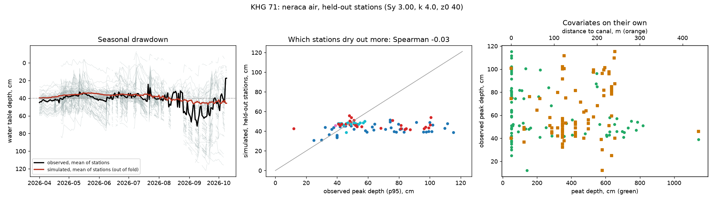

# Run report: kampar_gaung

Generated by `python -m subkhg.report --subkhg-config configs/kampar_gaung/subkhg.yaml --neraca-config configs/kampar_gaung/neraca.yaml` from the output folders of the run. Numbers only; decisions and their reasons are in the runbook.

## 1. Sub-KHG

- 26 sub-KHG from `data_local\out_delineate\subkhg_units.gpkg`; area (km2) min 132, median 202, max 885, total 7,109

## 2. Neraca air against SiTMAT stations

- Stations inside the KHG: 86 (2026-04-01 to 2026-10-09); peat depth filled by the KHG median for 0
- Fitted on all stations: Sy 3.0, k 4.0 mm/day, z0 40.0 cm (grids: Sy up to 3.0, k up to 4.0, z0 up to 40.0; a value at the upper end means the fit hit the edge of the grid)
- Drainage term kept: True (out-of-fold RMSE gain 19%)
- **Verdict: usable for ranking = False** (no spatial skill across held-out stations; does not beat the no-skill baseline)

Scored on stations in spatial blocks that were left out of the fit:

| model | RMSE cm | baseline RMSE cm | temporal r (median) | temporal r (IQR) | spatial rho peak | spatial rho days>40 | peak RMSE cm | baseline peak RMSE cm |
|---|---|---|---|---|---|---|---|---|
| with drainage | 16.5 | 15.3 | 0.63 | 0.36 to 0.82 | -0.03 | -0.02 | 29.8 | 24.0 |
| without drainage | 20.4 | 15.3 | 0.13 | -0.03 to 0.39 | -0.10 | n/a | 39.0 | 24.0 |

Baseline: every station follows the mean observed curve of the stations used for the fit. Temporal r is the per-station correlation of the daily series; spatial rho is across stations.

Single covariates on their own (Spearman with the observed value): peak_vs_peat_depth -0.22, peak_vs_canal_distance 0.28, days_gt40_vs_peat_depth -0.03, days_gt40_vs_canal_distance 0.20

### Station covariates (86 stations)

Spearman correlation of each covariate with the observed water-table depth over the dry season (peak = 95th percentile depth, days > 40 = share of days deeper than 40 cm).

| covariate | rho with observed peak depth | rho with days deeper than 40 cm |
|---|---|---|
| peat_depth_cm | -0.22 | -0.03 |
| canal_dist_m | 0.28 | 0.2 |
| elev_m | -0.24 | -0.07 |
| relief_2km_m | 0.04 | 0.11 |
| elev_minus_min2km | 0.17 | 0.21 |
| canal_density_500m | 0.02 | 0.11 |
| dist_primary_canal_m | 0.17 | 0.17 |
| dist_river_m | 0.01 | 0.27 |
| dist_khg_edge_m | 0.25 | 0.34 |
| ndmi_2019 | -0.1 | -0.05 |
| ndvi_2019 | 0.2 | 0.17 |

Observed peak depth: 10th percentile 40 cm, median 53 cm, 90th percentile 99 cm.
Stations whose peat depth is within 2 cm of the raster minimum (50 cm): 37 of 86.

### Spread of each output across the sub-KHG

| output | min | median | max | rho with mean peat depth | rho with canal proximity |
|---|---|---|---|---|---|
| u_wb_daily_mean | 1.52 | 2.48 | 3.00 | -0.80 | 0.50 |
| u_deficit_months_dry | 0.67 | 1.00 | 1.33 | -0.17 | -0.22 |
| u_dry_days_mean | 1.75 | 2.10 | 2.63 | 0.53 | -0.55 |
| u_storage_decline_pct | 4.75 | 74.09 | 83.59 | -0.91 | 0.58 |
| u_wt_peak_cm | 33.41 | 40.04 | 44.06 | 0.04 | 0.82 |
| u_wt_days_gt40 | 0.00 | 0.20 | 0.29 | 0.26 | 0.68 |

## 3. Sub-KHG ranking

- 26 sub-KHG; method that sets `kelas` and `peringkat`: **need**
- Indicators scored in the need score: u_ndmi, u_fire_freq, u_hotspot, u_canal_density, u_tma, u_tma_recession, u_ipg_gap, i_peat_depth, i_forest, f_reach, f_water_dist, f_lift
- Rank-sum indicators used: u_ndmi, u_ndvi, i_peat_depth, u_storage_decline_pct, u_wb_daily_mean, u_deficit_months, u_dry_days_mean, u_hotspot; not available: none
- Classes: Kebutuhan intervensi: tinggi: 9; Kebutuhan intervensi: rendah: 9; Kebutuhan intervensi: sedang: 8
- Agreement of the two methods: {'spearman': 0.6704273504273504, 'top5_overlap': 0.6, 'n_units': 26}
- Strongly correlated indicator pairs: u_canal_density/f_reach (0.884), i_peat_depth/f_lift (-0.87)

- `neraca_skill_ok` of the merged neraca air columns: 0 (0 = failed the skill check)

### Indicator values across the sub-KHG (raw)

| column | units with a value | min | median | max |
|---|---|---|---|---|
| i_peat_depth | 25 | 0.500 | 0.515 | 8.822 |
| f_reach | 26 | 0.042 | 0.541 | 0.853 |
| u_canal_density | 26 | 0.166 | 1.829 | 3.013 |
| n_sekat_ada | 26 | 0.000 | 7.000 | 834.000 |
| n_sekat_perlu | 26 | 0.000 | 32.000 | 343.000 |
| sekat_tambahan | 26 | 0.000 | 11.500 | 167.000 |
| m_ipg | 25 | 0.000 | 0.197 | 5.522 |
| kemiringan_kanal | 25 | 0.000 | 0.000 | 0.001 |
| u_ndmi | 26 | 0.259 | 0.374 | 0.445 |
| u_ndvi | 26 | 0.654 | 0.704 | 0.766 |
| u_fire_freq | 26 | 0.000 | 0.002 | 0.057 |
| u_hotspot | 26 | 0.000 | 0.181 | 1.391 |
| i_forest | 26 | 0.000 | 0.702 | 0.937 |
| f_water_dist | 26 | 1184.963 | 8495.981 | 27812.682 |
| f_lift | 26 | 0.470 | 2.133 | 9.542 |
| u_tma | 17 | 0.000 | 0.288 | 0.652 |
| n_tma_stations | 26 | 0.000 | 1.000 | 21.000 |
| u_wb_daily_mean | 26 | 1.520 | 2.477 | 3.004 |
| u_storage_decline_pct | 25 | 4.745 | 74.089 | 83.585 |
| u_wt_days_gt40 | 26 | 0.000 | 0.197 | 0.290 |

Canal blocks counted: existing 2754, needed by the spacing rule 1642.

### Canal slope and block spacing (metrik IPG)

- Median canal slope per sub-KHG, from the DTM: min / 25% / median / 75% / max = 0.00003 / 0.00016 / 0.00025 / 0.00044 / 0.00069
- Block spacing is dA / slope with dA = 0.4 m, kept between 50 and 2000 m. A slope below 0.00020 gives the maximum spacing: **11 of 25 sub-KHG** are at that cap, so for them the number of blocks needed is the canal length divided by the maximum spacing, not a result of the terrain.

Sub-KHG whose mean peat depth is within 2 cm of the lowest value (0.50 m, the raster floor): 13 of 25.

### Rank agreement with single indicators (Spearman)

| indicator | need score | rank-sum score |
|---|---|---|
| u_ndmi | -0.33 | -0.48 |
| u_ndvi | -0.36 | -0.44 |
| i_peat_depth | 0.67 | 0.40 |
| i_forest | -0.17 | -0.04 |
| f_reach | 0.20 | 0.19 |
| f_water_dist | 0.61 | 0.32 |
| u_hotspot | 0.35 | 0.50 |
| u_storage_decline_pct | -0.53 | -0.31 |
| u_wt_days_gt40 | 0.61 | 0.47 |

### Top 10 by the method in use

| unit | class | rank | rank by need score | rank by rank-sum | km2 |
|---|---|---|---|---|---|
| 71_S26 | Kebutuhan intervensi: tinggi | 1 | 1 | 1 | 281 |
| 71_S07 | Kebutuhan intervensi: tinggi | 2 | 2 | 3 | 151 |
| 71_S12 | Kebutuhan intervensi: tinggi | 3 | 3 | 8 | 404 |
| 71_S22 | Kebutuhan intervensi: tinggi | 4 | 4 | 2 | 160 |
| 71_S09 | Kebutuhan intervensi: tinggi | 5 | 5 | 9 | 692 |
| 71_S25 | Kebutuhan intervensi: tinggi | 6 | 6 | 7 | 175 |
| 71_S01 | Kebutuhan intervensi: tinggi | 7 | 7 | 17 | 202 |
| 71_S16 | Kebutuhan intervensi: tinggi | 8 | 8 | 11 | 885 |
| 71_S17 | Kebutuhan intervensi: tinggi | 9 | 9 | 10 | 522 |
| 71_S14 | Kebutuhan intervensi: sedang | 10 | 10 | 15 | 196 |

