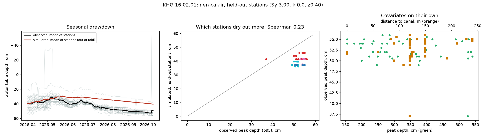

# Run report: sugihan_lumpur

Generated by `python -m subkhg.report --subkhg-config configs/sugihan_lumpur/subkhg.yaml --neraca-config configs/sugihan_lumpur/neraca.yaml` from the output folders of the run. Numbers only; decisions and their reasons are in the runbook.

## 1. Sub-KHG

- 28 sub-KHG from `data_local\out_delineate_sl\subkhg_units.gpkg`; area (km2) min 101, median 161, max 1358, total 6,346

## 2. Neraca air against SiTMAT stations

- Stations inside the KHG: 51 (2026-04-01 to 2026-10-09); peat depth filled by the KHG median for 0
- Fitted on all stations: Sy 3.0, k 0.0 mm/day, z0 40.0 cm (grids: Sy up to 3.0, k up to 4.0, z0 up to 40.0; a value at the upper end means the fit hit the edge of the grid)
- Drainage term kept: False (out-of-fold RMSE gain 43%)
- **Verdict: usable for ranking = False** (no spatial skill across held-out stations; does not beat the no-skill baseline)

Scored on stations in spatial blocks that were left out of the fit:

| model | RMSE cm | baseline RMSE cm | temporal r (median) | temporal r (IQR) | spatial rho peak | spatial rho days>40 | peak RMSE cm | baseline peak RMSE cm |
|---|---|---|---|---|---|---|---|---|
| with drainage | 6.4 | 5.7 | 0.90 | 0.87 to 0.93 | 0.01 | -0.17 | 5.5 | 3.1 |
| without drainage | 11.3 | 5.7 | 0.77 | 0.67 to 0.84 | 0.23 | -0.07 | 13.3 | 3.1 |

Baseline: every station follows the mean observed curve of the stations used for the fit. Temporal r is the per-station correlation of the daily series; spatial rho is across stations.

Single covariates on their own (Spearman with the observed value): peak_vs_peat_depth -0.14, peak_vs_canal_distance 0.23, days_gt40_vs_peat_depth -0.11, days_gt40_vs_canal_distance 0.13

### Station covariates (51 stations)

Spearman correlation of each covariate with the observed water-table depth over the dry season (peak = 95th percentile depth, days > 40 = share of days deeper than 40 cm).

| covariate | rho with observed peak depth | rho with days deeper than 40 cm |
|---|---|---|
| peat_depth_cm | -0.14 | -0.11 |
| canal_dist_m | 0.23 | 0.13 |
| elev_m | -0.11 | -0.06 |
| relief_2km_m | 0.03 | 0.04 |
| elev_minus_min2km | -0.09 | -0.0 |
| canal_density_500m | -0.3 | -0.03 |
| dist_primary_canal_m | -0.21 | -0.14 |
| dist_river_m | -0.59 | -0.15 |
| dist_khg_edge_m | 0.11 | 0.09 |
| ndmi_2019 | 0.05 | -0.01 |
| ndvi_2019 | 0.01 | 0.06 |

Observed peak depth: 10th percentile 51 cm, median 53 cm, 90th percentile 55 cm.
Stations whose peat depth is within 2 cm of the raster minimum (154 cm): 2 of 51.

### Spread of each output across the sub-KHG

| output | min | median | max | rho with mean peat depth | rho with canal proximity |
|---|---|---|---|---|---|
| u_wb_daily_mean | 0.43 | 1.15 | 2.37 | 0.20 | 0.25 |
| u_deficit_months_dry | 1.67 | 2.00 | 2.00 | 0.03 | 0.19 |
| u_dry_days_mean | 2.92 | 3.19 | 4.25 | 0.09 | -0.24 |
| u_storage_decline_pct | 7.89 | 27.99 | 69.17 | -0.98 | -0.51 |
| u_wt_peak_cm | 22.79 | 31.88 | 35.10 | -0.20 | -0.08 |
| u_wt_days_gt40 | 0.00 | 0.00 | 0.03 | -0.10 | -0.04 |

## 3. Sub-KHG ranking

- 28 sub-KHG; method that sets `kelas` and `peringkat`: **need**
- Indicators scored in the need score: u_ndmi, u_fire_freq, u_hotspot, u_canal_density, u_ipg_gap, i_peat_depth, i_forest, f_reach, f_water_dist, f_lift
- Rank-sum indicators used: u_ndmi, u_ndvi, i_peat_depth, u_storage_decline_pct, u_wb_daily_mean, u_deficit_months, u_dry_days_mean, u_hotspot; not available: none
- Classes: Kebutuhan intervensi: tinggi: 10; Kebutuhan intervensi: sedang: 9; Kebutuhan intervensi: rendah: 9
- Agreement of the two methods: {'spearman': 0.15300397022987336, 'top6_overlap': 0.3333333333333333, 'n_units': 28}
- Strongly correlated indicator pairs: u_canal_density/f_reach (0.89), i_peat_depth/f_water_dist (0.819), i_peat_depth/f_lift (-0.831), f_water_dist/f_lift (-0.807)

- `neraca_skill_ok` of the merged neraca air columns: 0 (0 = failed the skill check)

### Indicator values across the sub-KHG (raw)

| column | units with a value | min | median | max |
|---|---|---|---|---|
| i_peat_depth | 26 | 0.500 | 1.294 | 4.511 |
| f_reach | 28 | 0.122 | 0.621 | 0.933 |
| u_canal_density | 28 | 0.553 | 2.241 | 3.985 |
| n_sekat_ada | 28 | 0.000 | 68.500 | 856.000 |
| n_sekat_perlu | 28 | 32.000 | 104.500 | 1422.000 |
| sekat_tambahan | 28 | 0.000 | 47.500 | 1422.000 |
| m_ipg | 28 | 0.000 | 0.544 | 3.817 |
| kemiringan_kanal | 28 | 0.000 | 0.001 | 0.003 |
| u_ndmi | 28 | 0.039 | 0.333 | 0.415 |
| u_ndvi | 28 | 0.332 | 0.707 | 0.754 |
| u_fire_freq | 28 | 0.000 | 0.013 | 0.139 |
| u_hotspot | 28 | 0.000 | 0.080 | 1.182 |
| i_forest | 28 | 0.000 | 0.418 | 0.793 |
| f_water_dist | 28 | 526.267 | 8602.738 | 23674.122 |
| f_lift | 26 | 0.159 | 1.923 | 8.316 |
| u_tma | 12 | 0.532 | 0.621 | 0.748 |
| n_tma_stations | 28 | 0.000 | 0.000 | 9.000 |
| u_wb_daily_mean | 28 | 0.433 | 1.154 | 2.365 |
| u_storage_decline_pct | 26 | 7.893 | 27.986 | 69.174 |
| u_wt_days_gt40 | 28 | 0.000 | 0.000 | 0.033 |

Canal blocks counted: existing 2847, needed by the spacing rule 6314.

### Canal slope and block spacing (metrik IPG)

- Median canal slope per sub-KHG, from the DTM: min / 25% / median / 75% / max = 0.00005 / 0.00036 / 0.00057 / 0.00075 / 0.00332
- Block spacing is dA / slope with dA = 0.4 m, kept between 50 and 2000 m. A slope below 0.00020 gives the maximum spacing: **4 of 28 sub-KHG** are at that cap, so for them the number of blocks needed is the canal length divided by the maximum spacing, not a result of the terrain.

Sub-KHG whose mean peat depth is within 2 cm of the lowest value (0.50 m, the raster floor): 4 of 26.

### Rank agreement with single indicators (Spearman)

| indicator | need score | rank-sum score |
|---|---|---|
| u_ndmi | -0.50 | -0.70 |
| u_ndvi | -0.58 | -0.64 |
| i_peat_depth | 0.44 | -0.13 |
| i_forest | -0.44 | -0.01 |
| f_reach | 0.24 | -0.06 |
| f_water_dist | 0.33 | -0.29 |
| u_hotspot | 0.44 | 0.43 |
| u_storage_decline_pct | -0.51 | 0.15 |
| u_wt_days_gt40 | -0.14 | 0.57 |

### Top 10 by the method in use

| unit | class | rank | rank by need score | rank by rank-sum | km2 |
|---|---|---|---|---|---|
| 16.02.01_S21 | Kebutuhan intervensi: tinggi | 1 | 1 | 18 | 423 |
| 16.02.01_S27 | Kebutuhan intervensi: tinggi | 2 | 2 | 5 | 193 |
| 16.02.01_S23 | Kebutuhan intervensi: tinggi | 3 | 3 | 9 | 137 |
| 16.02.01_S02 | Kebutuhan intervensi: tinggi | 4 | 4 | 3 | 106 |
| 16.02.01_S25 | Kebutuhan intervensi: tinggi | 5 | 5 | 20 | 412 |
| 16.02.01_S26 | Kebutuhan intervensi: tinggi | 6 | 6 | 21 | 232 |
| 16.02.01_S04 | Kebutuhan intervensi: tinggi | 7 | 7 | 2 | 155 |
| 16.02.01_S06 | Kebutuhan intervensi: tinggi | 8 | 8 | 13 | 123 |
| 16.02.01_S03 | Kebutuhan intervensi: tinggi | 9 | 9 | 1 | 141 |
| 16.02.01_S15 | Kebutuhan intervensi: tinggi | 10 | 10 | 25 | 152 |

